# 微光2026招新-Web后端-07

## Part 1

### Task 1

1. **创建一个数据库（后补）：**

    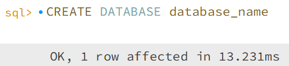

2. **创建表：**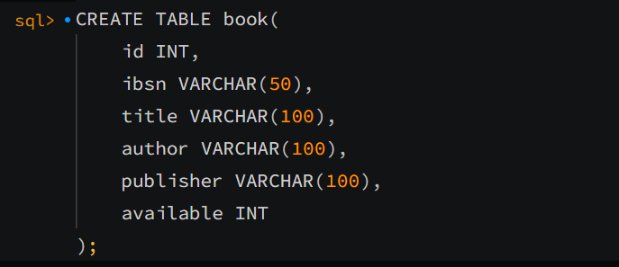

3. **插入数据：**

    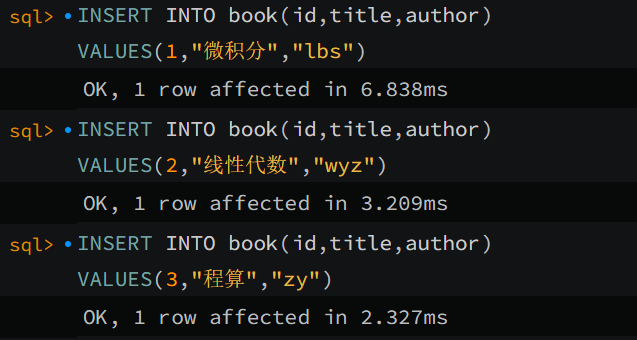

-----

### Task 2

1. **查询所有书籍信息：**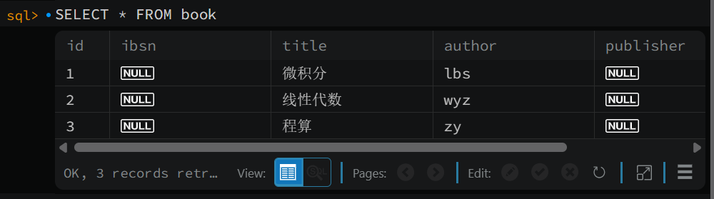

2. **查询指定书籍信息：**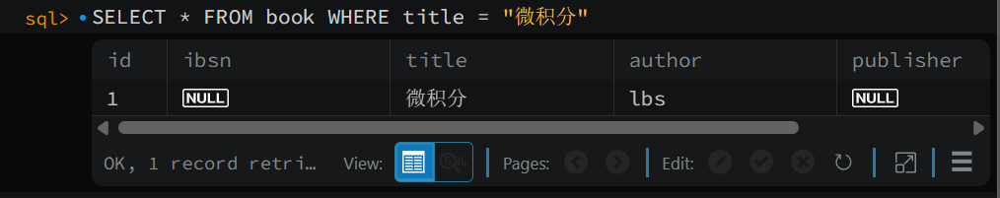

3. **修改某个书籍信息：**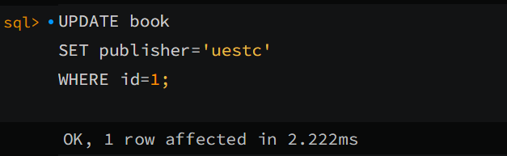

   **->**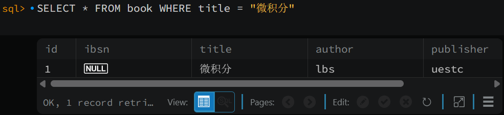

4. **删除指定书籍数据**：

   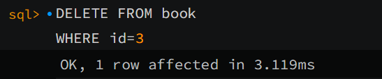

   **->**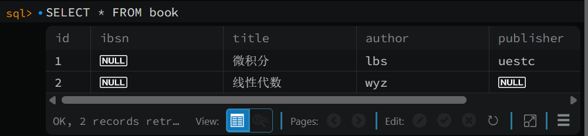

----

### Task 3

1. 我选择了**id**字段为唯一标识。因为每本书的id一定是独一无二的，并且与ISBN相比id要更容易记忆或查找。（其实我做完才发现ISBN打错了，校队这一块）
2. 存在名称相同的情况可以开一个副本表存每一本具体的书，通过外键与总表联系。

​    *. 对MySQL的理解：优点主要体现在上手简单以及有成熟的生态，使得初学入门十分容易。适合做一些规模不是特别大的管理项目，比如上面的图书管理系统。缺点是大规模管理能力较弱（不过我也暂时没遇到就是了），而且这应该也是推动nosql诞生的一大动力，牺牲一部分关联系获得更高的读写速度等。

----

## Part 2

0. **解释镜像与容器的区别**

   镜像是一个设定好的模版，容器是根据这个模版创建出来的具体的一个实例。

1. **获取、部署与挂载**：

   `docker pull mysql:8.0`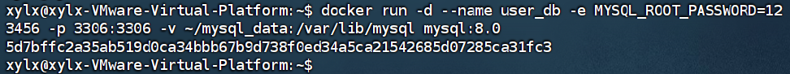

2. **进入容器内部：**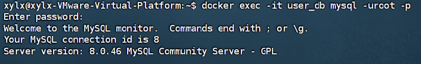

3. **落库：**

   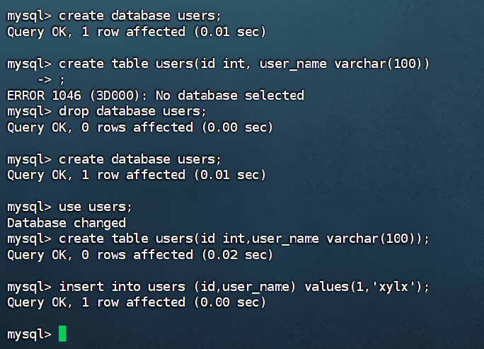

4. **删除验证：**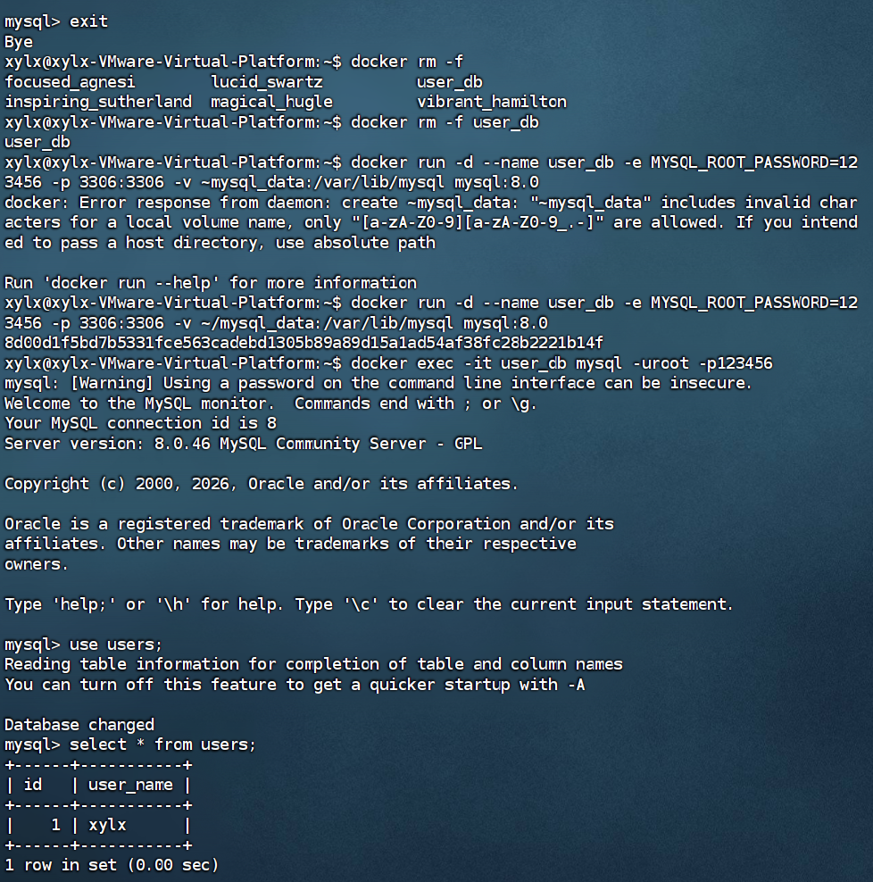

5. **总结**

   - 实际上最恼火的part是安装docker，第一次安装的时候把系统搞的一团浆糊然后恢复快照了。不过这个讨论价值不是很大。
   - 比较有讨论价值的是部署、挂载那一串长代码。因为我一开始以为部署是一点一点来的（类似于一个msi），所以就裸写`docker run -d mysql:8.0`，然后就报错了，说是要设置密码。第二个是我学到的用'\\'来转义换行增强可读性，但是我没有加空格，导致实际上我的代码是全部粘在一起，换行了滚木，我觉得也比较有意思。
   - 关于出题，我觉得一个比较有意思的是在linux里并不存在`/var/lib/mysql`这个目录，我当时还以为是自己少建了，但是实际上这个是容器里的，而挂载的`~/mysql_data`才是虚拟机上存在的目录，这也是挂载存在的意义：让写入容器的数据在虚拟机上储存，从而安全保存数据。这个问题本质并不难，但是涉及到了docker的底层逻辑，我觉得是不错的。
   - 以及同样的一个概念问题：我建成了数据库名是users，user_db其实是容器的名字:cry:

---

## Part 3

1. **配置文件代码**（更改部分，完整的会附在07/images/Task3/nginx.conf）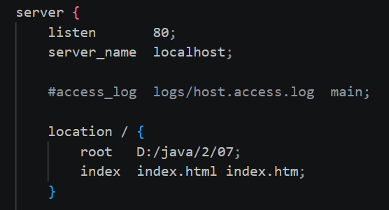

2. **运行截图：**

   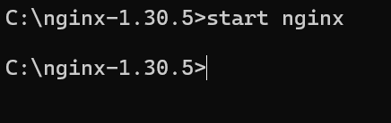

   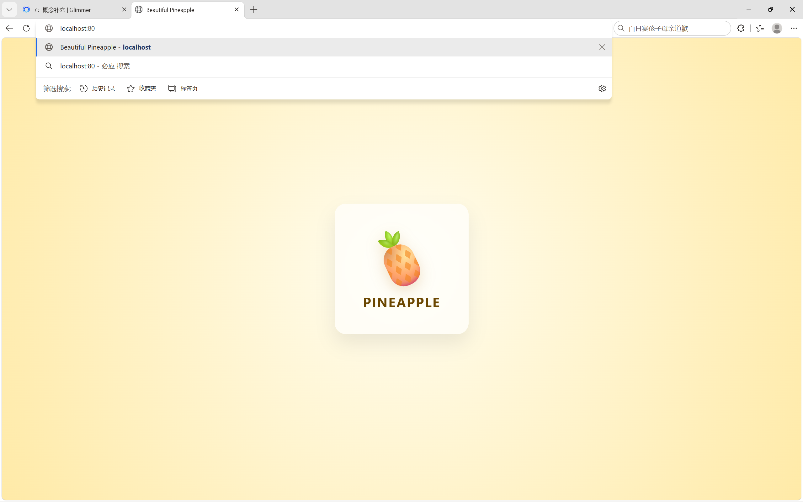

​	**这里用windows而不是linux是因为下面http部分要用windows做，而且这两个系统改一下conf里的地址就可以实现相同效果了*

---

## Part 4

### Task 0

1. **HTTP**

   HTTP是一种用户端和服务端之间进行传输的协议，基于请求-响应模型。它的作用在于建立了一套统一的通信系统，使得不同系统能通过同一套标准进行数据交换，并且扩展了传输数据的类型以及增强了对复杂环境的适应力，成为现在网络通信的基础。

2. **常见状态码**

   - 2xx：成功
     - 200 OK：请求成功
   - 3xx：重定向
   - 4xx：客户端错误
     - 404 Not Found：资源不存在
   - 5xx：服务端错误
     - 502 Bad Gateway：无效响应

---

### Task 1

*（请求响应的原文见07/images/Task4/\*.txt）*

- 请求使用的method是：GET

- 请求头中有：包括但不限于：

  - Host：访问目标
  - Content-Type：内容类型
  - User-Agent：我是谁

- 返回内容：包括但不限于：

  - 状态码：200 OK
  - Content-Type：内容类型
  - Date：时间
  - 响应体

- 请求通常包含：

  - 请求行：请求方法、URL、HTTP版本
  - 请求头：附加说明：我是谁，我的内容是什么格式……
  - 空行：分隔请求头和请求体
  - 请求体：我要提交的内容（GET一般没有）

  *（响应基本上是一一对应的）*

- 常见请求方法：

  | 请求方法 | 作用                 | 适用场景     |
  | -------- | -------------------- | ------------ |
  | GET      | 把东西给我           | 浏览，查询   |
  | POST     | 我提交东西，请你处理 | 登录，提交   |
  | PUT      | 把某个东西整个换掉   | 替换信息     |
  | PATCH    | 把某个东西部分换掉   | 修改信息     |
  | DELETE   | 删出某个东西         | 删除         |
  | HEAD     | 只获取响应头         | 测试链接     |
  | OPTIONS  | 问我能干嘛           | 查看能干什么 |

---

### Task 2

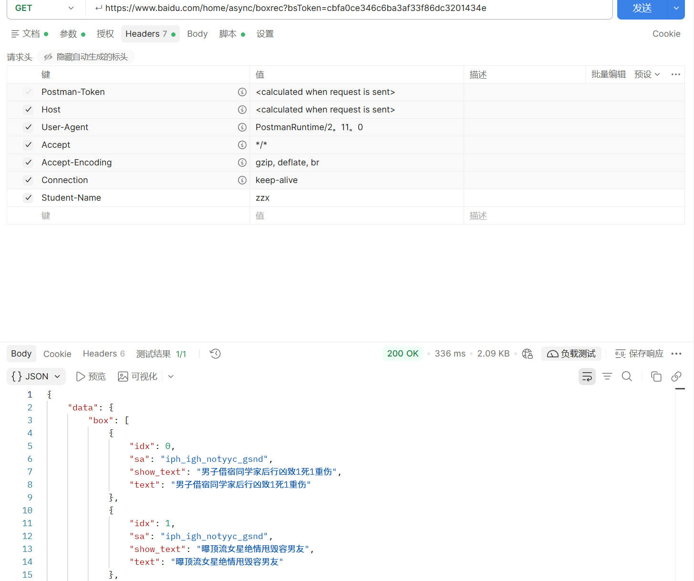

- **思考**
  1. Header的作用是附加说明。因为请求行只有方法、路径和版本，但是服务器还需要指定比如域名、请求头格式、长度等等必要信息，这些就存在Header里。
  2. 最简单的GET可能可以，但是稍微复杂一点比如POST，如果我不给Content-Type，那么服务器就不知道我请求体到底传了个什么格式，就会导致解析失败。
  3. 常见Header（这里给出Postman的默认Header）：
     - Host：域名端口
     - User-Agent：我是谁（浏览器、操作系统等）
     - Accept：客户端能接受的响应类型
     - Accept-Encoding：能接受的压缩编码
     - Connection：连接管理（如keep-alive 保持连接）

---

### Task 3

- 3-1：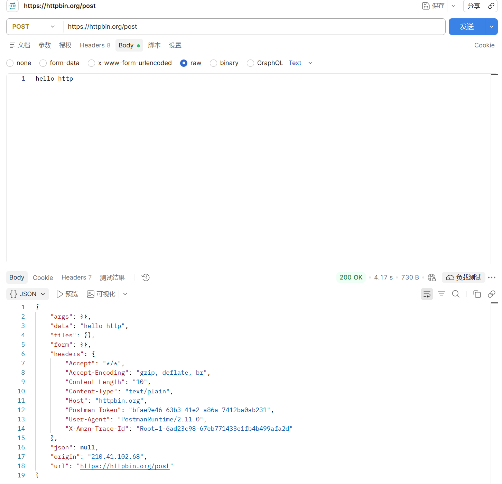
- 3-2：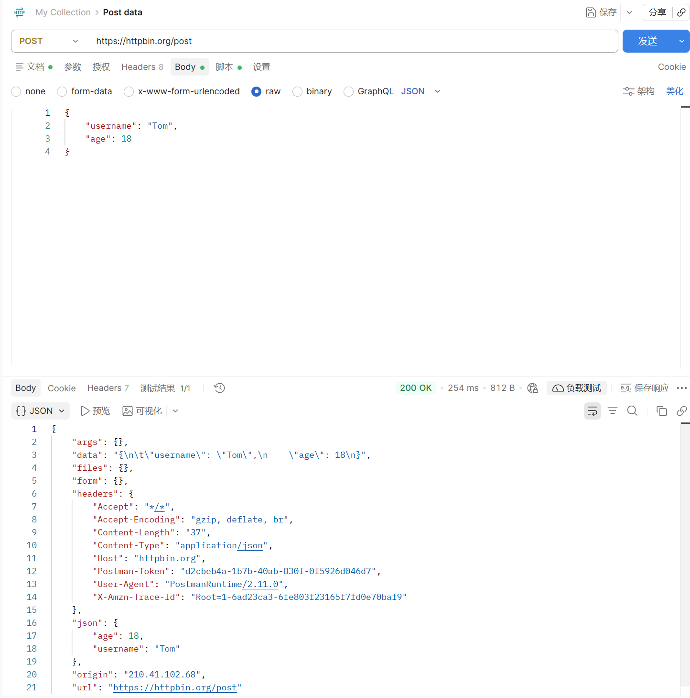
- **思考**
  1. 因为GET是类似于只读，改不了服务器状态，只能获取。但是“提交”这一动作是要修改数据的，所以要用POST。
  2. 设置Content-Type的原因上面也提到了，就算服务器拿到了数据，一串字节，但是它不知道用什么方法来解析数据，就会出现解析失败或者错误。

---

### Task 4

- **请求头：**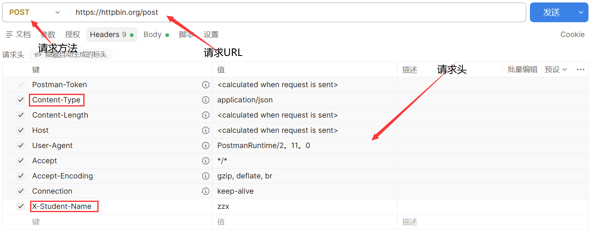
- **请求体：**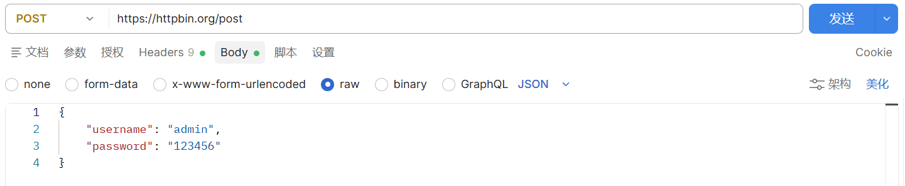
- **响应头：**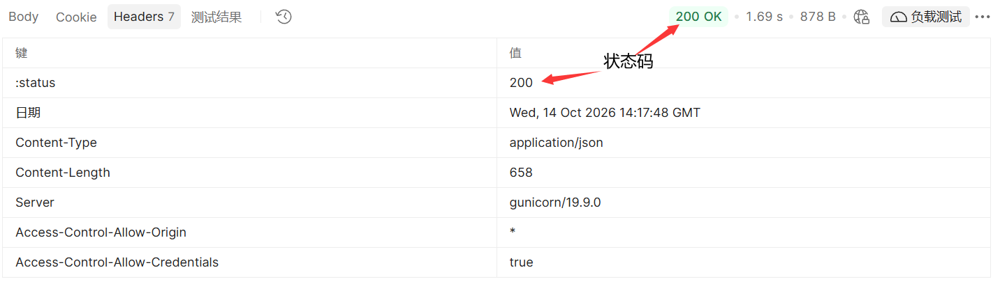
- **响应体：**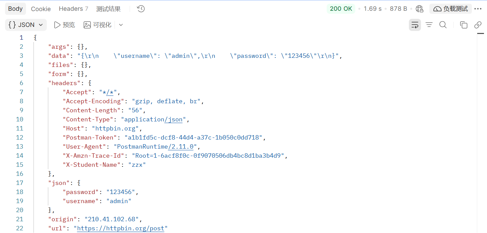
- **思考**
  1. 因为“登录”这一操作是要请服务器处理一些东西的（比如说cookie），单纯GET获取做不到这一点。
  2. 同上防止解析失败或错误。
  3. 不应该，URL是暴露的，用户名和密码直接放在URL会造成个人信息泄露。

---

## 拓展思考题

1. **验证码**

   - 用POST是因为“发送验证码”这一行为需要服务器做一些事情（比如生成验证码），单纯的GET方法只能拿到一个已经存在的东西，不能让服务器干什么。

   - 因为GET没有动服务器，只是把东西拿出来，拿一百遍服务器的状态也不会变，只是浪费一点流量。但是每次POST服务器都要处理一些东西，POST一百次服务器就要处理一百次，就可能因重复操作而出现卡顿等。

   - 最简单粗暴的应该是“60秒后重新发送”，不让重复POST。或者验证ip，限制同一ip的访问次数。

2. **报名表**
   - 因为刷新会再POST一次提交的内容。假设我付款卡了，如果浏览器不问一下刷新再扣一次款那就炸了。这个提醒一定程度上可以减少POST被反复执行出现的问题。
3. **格式**
   - 答：是的。响应头会告诉你Content-Type是什么类型。

